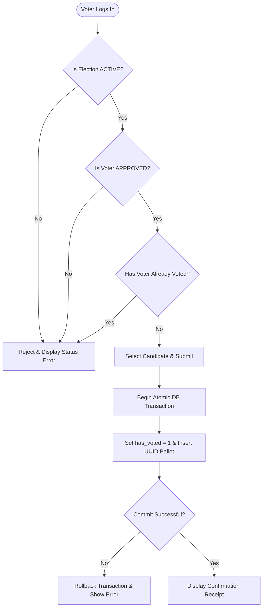

# 🗳️ GP11 Election Management and Voting System (`GP11_EMV_System`)

A secure, privacy-preserving web-based Election Management and Voting System prototype built with Python, Flask, and SQLite. Developed by **Group 11 (GP11)** to demonstrate requirement engineering, role-based access control, atomic ballot processing, and automated validation.

---

## ✨ Key Features & Requirements Coverage

### 1. Functional Capabilities
* **User Registration & Authentication:** Voter self-registration and secure credential validation for both Administrators and Voters.
* **Role-Based Access Control (RBAC):** Strict separation between Administrator management functions and Voter participation interfaces.
* **Election Lifecycle Management:** New elections are private `DRAFT`s. After an administrator confirms a complete roster of at least two candidates, the election follows its configured `UPCOMING`, `ACTIVE`, and `CLOSED` times.
* **Early Election Closure:** Administrators can end an active election early, publish results immediately, and record the action in the audit log.
* **Closed Election Deletion:** Administrators can permanently delete a closed election from its detail page after confirming a warning dialog. Associated voting data is removed while administrative audit logs are retained.
* **Candidate Management:** Administrators can add, edit, or remove candidates while an election is `DRAFT` or `UPCOMING`. Name and manifesto are required; duplicate names are allowed. Candidate lists lock once voting begins. Changing a confirmed roster returns the election to draft and requires confirmation again.
* **Voter Eligibility Workflow:** Voters can request participation in specific elections (`PENDING`), and Administrators can approve (`APPROVED`) or reject (`REJECTED`) eligibility requests.
* **Electronic Voting & Duplicate Prevention:** Approved voters can cast exactly one ballot during an `ACTIVE` election and receive an immediate confirmation receipt ID.
* **Automated Vote Counting & Publication:** Tallies and percentages remain sealed during active voting and are automatically calculated and published once the election reaches the `CLOSED` state.
* **Administrative Audit Trail:** Records election creation, edits and deletion, candidate additions/edits/removals, roster confirmation, voter eligibility decisions, and early closure with timestamps. Changes and their previous/new values are committed together with their audit entry. Unchanged submissions do not add audit records or revoke confirmation.

### Prepare and Confirm an Election

1. Create an election with its title, description, and start/end times. It remains a private **DRAFT**, even when the start time has already arrived.
2. Open the election and add at least **two candidates**. Every candidate must have a non-blank name and manifesto. Adding candidates never starts voting automatically.
3. To edit a candidate, expand **Edit** next to that candidate and use **Save Candidate**. Stale, altered, or deleted-candidate forms are rejected. Candidate IDs are preserved.
4. Review **Election Readiness**, fix any missing information or expired end time, then click **Confirm Election**. Voting starts immediately if the start time has arrived, or automatically at the future scheduled time.

Draft elections are hidden from voters, including direct links and participation/voting endpoints. Existing participation requests remain stored when an election returns to draft. Before voting begins, adding, editing, or removing a confirmed candidate revokes confirmation; confirm the complete roster again afterward. Once voting starts, the roster is locked.

Candidate editing uses administrator-only POST `/admin/election/<election_id>/candidate/<cand_id>/update` with `name`, `manifesto`, and `edit_token`. Confirmation uses POST `/admin/election/<election_id>/confirm` with `confirmation_token`. Signed form snapshots prevent stale candidate edits and confirmation of a changed roster or schedule. Candidate changes, confirmation, and voting recheck current state after obtaining a SQLite write lock.

### Election Editing Rules

Administrators can open an election and use the **Edit Election** panel. The form is prefilled with the current details.

| Current state | Editable fields |
| :--- | :--- |
| `DRAFT` | Title, description, start time, and end time; an expired draft can be rescheduled |
| `UPCOMING` | Title, description, start time, and end time |
| `ACTIVE` | Title, description, and end time; the start time is locked and the end time may only stay the same or be extended |
| `CLOSED` | None; election settings are locked |

The title must contain non-whitespace text; the description may be empty. Both times must be valid dates in `YYYY-MM-DDTHH:MM` format, with the start before the end. When editing a confirmed upcoming election, the start time must remain in the future. A draft remains editable after its original end time, but must have an unexpired end time before confirmation. Closed elections cannot be reopened through editing. The existing **End Election Early** action remains available for active elections.

Edits use the administrator-only POST route `/admin/election/<election_id>/update` with `title`, `description`, `start_time`, and `end_time` fields. The backend acquires a SQLite write lock (`BEGIN IMMEDIATE`) before reloading the election and applying the state rules. A stale form cannot shorten a more recently extended end time or overwrite an election that has already closed. The edit and its audit entry are committed or rolled back together; candidates, participation requests, and accepted ballots are preserved. Submitting unchanged values does not create an audit entry.

### Delete a Closed Election

As an administrator, open a **CLOSED** election and click **Delete Election**. The custom confirmation dialog identifies the election and warns that its settings, candidates, ballots, published results, and participation records will be permanently deleted and cannot be recovered. Existing administrative audit logs are retained, and the deletion records the administrator, election ID, title, and timestamp. Other elections and user accounts are preserved.

Only **Confirm Deletion** submits the request. **Cancel**, the close button, and Esc dismiss the dialog without deleting anything; Cancel receives the initial focus. JavaScript is required to enable the deletion controls. Both scheduled closure and **End Election Early** qualify; drafts (including expired drafts), upcoming elections, and active elections cannot be deleted.

Deletion uses administrator-only POST `/admin/election/<election_id>/delete` with `confirmed=yes` and a signed `deletion_token` bound to the election, administrator, and current login session. After acquiring a SQLite write lock, the backend reloads the latest state and requires `CLOSED`. Foreign-key cascades remove associated records; the deletion and its new audit entry commit or roll back together. Success returns to the election list. Repeated or missing-election requests do not create another deletion audit. No database migration or additional package is required.

### 2. Non-Functional & Privacy Architecture
* **Ballot Secrecy (Privacy by Design):** Voter participation status (`voter_participation` table) and actual candidate choices (`ballots` table) are stored in separate tables. The `ballots` table uses random UUIDs (`UUID v4`) and omits voter foreign keys and timestamps to prevent identity correlation.
* **ACID Data Integrity:** Ballot insertion and the voter's `has_voted` flag update are executed inside a single atomic SQLite transaction (`with db:`). Any unexpected failure triggers a full rollback.
* **Password Security:** All user passwords are salted and hashed using `werkzeug.security`.

---

## 🏗️ System Architecture

The application follows a modular **three-layer architecture**:
1. **Presentation Layer (Frontend):** Responsive Bootstrap 5 interface rendering dashboards, candidate lists, ballot forms, and live audit logs.
2. **Application Layer (Backend):** Python Flask controllers handling authentication, RBAC decorators (`@login_required`, `@admin_required`), eligibility verification, and atomic transaction control.
3. **Data Layer (Database):** Relational SQLite database (`election_system.db`) enforcing foreign key constraints, composite primary keys, and domain checks.



---

## 📂 Repository Structure

```text
GP11_EMV_System/
├── app.py                        # Development entry point
├── election_system/
│   ├── __init__.py               # Application factory and configuration
│   ├── auth.py                   # Authentication, registration and access checks
│   ├── elections.py              # Dashboard and election details
│   ├── voting.py                 # Participation and ballot submission
│   ├── admin.py                  # Election, candidate and eligibility management
│   ├── services.py               # Election status and atomic voting rules
│   ├── db.py                     # SQLite schema, connections, demo data and queries
│   └── templates/                # Shared layout and page templates
├── test_app.py                   # Automated Pytest suite
├── test_candidate_management.py  # Candidate, readiness, migration and race tests
├── test_election_deletion.py     # Deletion, confirmation, cascade and rollback tests
├── project_dependencies.txt      # Python package dependencies
└── README.md                     # Project documentation
```

The database defaults to `election_system.db` in the current working directory. Running `python app.py` initializes missing tables and seeds demo data only when no users exist. The demo election has two complete candidates and is already confirmed. Tests use `create_app({"TESTING": True, "DATABASE": ...})` to create isolated application instances.

Existing databases receive a one-time, transactional `is_confirmed` migration. Closed elections stay closed; unfinished elections with at least two complete candidates retain their schedule; unfinished elections with incomplete rosters and no ballots become drafts. Repeated initialization never reconfirms drafts or resets existing data.

The migration performs its preflight before changing the schema or data. If an unfinished election has accepted ballots but lacks two complete candidates, startup stops and lists its ID. Use the previous application version to end that election, then restart the upgrade. Ballots, participation requests, candidate IDs, and audit history are preserved.

### Naming and organization conventions

- Use `snake_case` for Python modules, functions, variables and template filenames, `PascalCase` for classes, and `UPPER_SNAKE_CASE` for constants.
- Keep related database operations together in `db.py`; route modules handle HTTP requests and services handle election and voting rules. Data helpers leave commits and rollbacks to their callers.
- Reuse the original section comments and add matching headings for new functional sections.
- Keep public URLs and database identifiers stable unless a change and migration are explicitly planned.

---

## 🚀 Installation & Setup Guide

### Prerequisites
* **Python 3.9+** installed on Windows, macOS, or Linux.

### Step 1: Clone the Repository
```powershell
git clone https://github.com/<your-username>/GP11_EMV_System.git
cd GP11_EMV_System
```

### Step 2: Create & Activate Virtual Environment (Windows PowerShell / PyCharm)
```powershell
py -m venv .venv
.\.venv\Scripts\activate
```
*(If `pip` is missing in your virtual environment, run `python -m ensurepip --upgrade` first).*

### Step 3: Install Dependencies
```powershell
python -m pip install -r project_dependencies.txt
```

### Step 4: Run the Application
```powershell
python app.py
```
Open your browser and navigate to: **`http://127.0.0.1:5000`**

---

## 🔑 Default Demo Accounts

When started for the first time, the system automatically seeds a sample active election (**Student Union Presidential Election**) and two test accounts:

| Role | Username | Password | Capabilities |
| :--- | :--- | :--- | :--- |
| **Administrator** | `admin` | `admin123` | Create and edit elections, manage candidates, approve/reject voters, view audit logs |
| **Voter** | `voter1` | `voter123` | Request election participation, view candidates, cast anonymous ballot |

### Quick Demo Walkthrough
1. Sign in as **`voter1`** (`voter123`), open **Student Union Presidential Election**, and click **Request Participation**.
2. Log out and sign in as **`admin`** (`admin123`). Open the election and click **Approve** next to `voter1` under *Voter Eligibility Management*.
3. Log out and sign back in as **`voter1`**. Select a candidate and click **Confirm & Submit Anonymous Ballot**.
4. Try submitting another vote or re-visiting the page to see duplicate-voting prevention in action.

To try election editing, sign in as **admin** and open an election. The active demo election allows title and description changes and an extended end time. Create a draft to edit all four fields and prepare its candidates. Once an election closes, the panel displays a locked message.

---

## 🧪 Running Automated Tests

The automated test suite uses temporary SQLite databases to verify authentication, role-based access, election and candidate management, template escaping, result visibility, atomic voting, duplicate prevention, database reinitialization, and early election closure.

Election-edit tests cover state-specific permissions and form controls, date and title validation, administrator-only POST access, stale end times, state changes while waiting for a write lock, audit failure rollback, and preservation of candidates, participation requests, and ballots.

Candidate/readiness tests also cover required names and manifestos, signed stale-form protection, independent edit forms, confirmation revocation, draft privacy, zero/one/two-candidate thresholds, scheduled and immediate activation, expired draft recovery, transaction rollback, actual SQLite lock waits, and legacy migration preflight and rollback.

Deletion tests cover administrator-only access and visibility, explicit confirmation, tokens bound to the election and login session, closed-state enforcement, complete cascading deletion, preservation of other elections and audit history, repeated requests, transaction rollback, escaped titles, and rechecking state after actual SQLite lock waits. The dialog flow is also checked in a real browser for cancellation, Esc, confirmation, and disabled JavaScript.

Run the test suite from your terminal:
```powershell
python -m pytest -v
```

---

## 🔮 Future Evolution Roadmap

This prototype is designed for internal organisational and student society elections. Planned future enhancements include:
* **Multiple Voting Methods:** Ranked-Choice (Instant-Runoff) and Approval voting modules.
* **Cryptographic E2E Verifiability:** Zero-knowledge ballot receipts and public bulletin board verification.
* **Configurable Result Visibility:** Optional live tallying and minimum quorum enforcement.
* **Accessibility & SSO:** WCAG 2.1 AA compliance and university/enterprise OAuth 2.0 integration.
