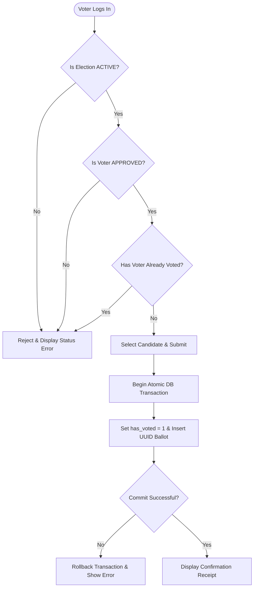

# 🗳️ GP11 Election Management and Voting System (`GP11_EMV_System`)

A secure, privacy-preserving web-based Election Management and Voting System prototype built with Python, Flask, and SQLite. Developed by **Group 11 (GP11)** to demonstrate requirement engineering, role-based access control, atomic ballot processing, and automated validation.

---

## ✨ Key Features & Requirements Coverage

### 1. Functional Capabilities
* **User Registration & Authentication:** Voter self-registration and secure credential validation for both Administrators and Voters.
* **Role-Based Access Control (RBAC):** Strict separation between Administrator management functions and Voter participation interfaces.
* **Election Lifecycle Management:** New elections are private `DRAFT`s. After an administrator confirms a complete roster of at least two candidates, the election follows its configured `UPCOMING`, `ACTIVE`, and `CLOSED` times.
* **Early Election Closure:** Administrators can end an active election early and publish results immediately. The application saves the actual closure time separately from the original schedule and commits it together with a single audit entry.
* **Election Deletion:** Administrators can permanently delete a draft, upcoming, or closed election from its detail page after confirming a warning dialog. Associated voting data is removed while administrative audit logs are retained. Active elections cannot be deleted.
* **Integrated Election Creation:** A dedicated administrator page shows election details and candidate entries together, side by side on desktop and stacked on mobile. Administrators can add several candidates before saving, or explicitly confirm creating an empty draft. Election settings, candidates, and their audit records are saved together or rolled back together.
* **Candidate Management:** Administrators can add, edit, or remove candidates while an election is `DRAFT` or `UPCOMING`. Name and manifesto are required, and names cannot consist only of numbers; duplicate names are allowed. Candidate lists lock once voting begins. Changing a confirmed roster returns the election to draft and requires confirmation again.
* **Voter Eligibility Workflow:** Voters can request participation in `UPCOMING` or `ACTIVE` elections (`PENDING`), and administrators can approve (`APPROVED`) or reject (`REJECTED`) eligibility requests before closure. Recording a ballot locks that voter's eligibility. Once an election is `CLOSED`, new requests and eligibility decisions are blocked. Both actions recheck the latest election state after acquiring a database write lock. Eligibility decisions and their audit entries commit or roll back together.
* **Electronic Voting & Duplicate Prevention:** Approved voters can cast exactly one ballot during an `ACTIVE` election and receive an immediate confirmation receipt ID.
* **Automated Vote Counting & Publication:** Tallies and percentages remain sealed during active voting and are automatically calculated and published once the election reaches the `CLOSED` state.
* **Administrative Audit Trail:** Records election creation, edits and deletion, candidate additions/edits/removals, roster confirmation, voter eligibility decisions, and early closure with timestamps. Administrators can open **Audit Log** from the navigation bar to view the latest 20 entries, then click **Load More** to append another 20 at a time. The election list uses the full dashboard width. Changes and their previous/new values are committed together with their audit entry. Unchanged submissions do not add audit records or revoke confirmation.

### Prepare and Confirm an Election

1. On the election list, click **Create New Election**. The dedicated page shows the title, optional description, start/end times, and candidate entries together. Use **Add Candidate** or **Remove** to prepare the roster. Each entered candidate needs both a name and manifesto; completely blank entries are skipped.
2. Click **Create Election** to save the election and candidates together and open its detail page. With no candidates, a dialog asks you to **Confirm Creation**; **Cancel**, the close button, or Esc returns to the unchanged form. Without JavaScript, the same confirmation appears on the page. New elections remain private **DRAFT**s, even when the start time has arrived or several candidates were included. You can still add or change candidates on the detail page; adding candidates never starts voting automatically.
3. To edit a candidate, expand **Edit** next to that candidate and use **Save Candidate**. Stale, altered, or deleted-candidate forms are rejected. Candidate IDs are preserved.
4. Review **Election Readiness**, fix any missing information or expired end time, then click **Confirm Election**. Voting starts immediately if the start time has arrived, or automatically at the future scheduled time.

Draft elections are hidden from voters, including direct links and participation/voting endpoints. Existing participation requests remain stored when an election returns to draft. Before voting begins, adding, editing, or removing a confirmed candidate revokes confirmation; confirm the complete roster again afterward. Once voting starts, the roster is locked.

Candidate editing uses administrator-only POST `/admin/election/<election_id>/candidate/<cand_id>/update` with `name`, `manifesto`, and `edit_token`. Confirmation uses POST `/admin/election/<election_id>/confirm` with `confirmation_token`. Signed form snapshots prevent stale candidate edits and confirmation of a changed roster or schedule. Candidate changes, confirmation, and voting recheck current state after obtaining a SQLite write lock.

Administrator-only GET `/admin/election/create` displays the creation page. POST to the same URL accepts `title`, `description`, `start_time`, `end_time`, and paired repeated `candidate_name` / `candidate_manifesto` fields. Invalid entries preserve the complete form for correction. Empty rosters require the explicit submit value `confirm_without_candidates=yes`; a missing or incorrect value displays the confirmation without saving anything. This acknowledgement only permits saving an empty draft; it does not confirm the election for voting. No database migration or additional package is needed.

### Election Editing Rules

Administrators can open an election and use the **Edit Election** panel. The form is prefilled with the current details.

| Current state | Editable fields |
| :--- | :--- |
| `DRAFT` | Title, description, start time, and end time; an expired draft can be rescheduled |
| `UPCOMING` | Title, description, start time, and end time |
| `ACTIVE` | Title, description, and end time; the start time is locked and the end time may only stay the same or be extended |
| `CLOSED` | None; election settings are locked |

The title must contain non-whitespace text; the description may be empty. Both times must be valid dates in `YYYY-MM-DDTHH:MM` format, with the start before the end. When editing a confirmed upcoming election, the start time must remain in the future. A draft remains editable after its original end time, but must have an unexpired end time before confirmation. Closed elections cannot be reopened through editing. The existing **End Election Early** action remains available for active elections.

Edits use the administrator-only POST route `/admin/election/<election_id>/update` with `title`, `description`, `start_time`, and `end_time` fields. The backend acquires a SQLite write lock (`BEGIN IMMEDIATE`) before reloading the election and applying the state rules. A stale form cannot shorten a more recently extended end time or overwrite an election that has already closed. The edit and its audit entry are committed or rolled back together; candidates, participation requests, and accepted ballots are preserved. Submitting unchanged values does not create an audit entry.

### Delete an Election

As an administrator, open a **DRAFT**, **UPCOMING**, or **CLOSED** election and click **Delete Election**. The custom confirmation dialog identifies the election and warns that its settings, candidates, ballots, published results, and participation records will be permanently deleted and cannot be recovered. Existing administrative audit logs are retained, and the deletion records the administrator, election ID, title, and timestamp. Other elections and user accounts are preserved.

Only **Confirm Deletion** submits the request. **Cancel**, the close button, and Esc dismiss the dialog without deleting anything; Cancel receives the initial focus. JavaScript is required to enable the deletion controls. Drafts (including expired drafts and drafts without candidates), upcoming elections, and elections closed on schedule or through **End Election Early** qualify. Active elections cannot be deleted.

Deletion uses administrator-only POST `/admin/election/<election_id>/delete` with `confirmed=yes` and a signed `deletion_token` bound to the election, administrator, and current login session. After acquiring a SQLite write lock, the backend reloads the latest state and requires `DRAFT`, `UPCOMING`, or `CLOSED`. If an upcoming election becomes active before submission or while waiting for the lock, deletion is rejected. Foreign-key cascades remove associated records; the deletion and its new audit entry commit or roll back together. Success returns to the election list. Repeated or missing-election requests do not create another deletion audit. No database migration or additional package is required.

### 2. Non-Functional & Privacy Architecture
* **Ballot Secrecy (Privacy by Design):** Voter participation status (`voter_participation` table) and actual candidate choices (`ballots` table) are stored in separate tables. The `ballots` table uses random UUIDs (`UUID v4`) and omits voter foreign keys and timestamps to prevent identity correlation.
* **ACID Data Integrity:** Ballot insertion and the voter's `has_voted` flag update are executed inside a single atomic SQLite transaction (`with db:`). Any unexpected failure triggers a full rollback.
* **Password Security:** All user passwords are salted and hashed using `werkzeug.security`.

---

## 🏗️ System Architecture

The application follows a modular **three-layer architecture**:
1. **Presentation Layer (Frontend):** Responsive Bootstrap 5 interface rendering dashboards, candidate lists, ballot forms, and live audit logs.
2. **Application Layer (Backend):** Python Flask controllers handling authentication, RBAC decorators (`@login_required`, `@admin_required`), eligibility verification, and atomic transaction control.
3. **Data Layer (Database):** Relational SQLite database (`election_system.db`) enforcing foreign key constraints, composite primary keys, and domain checks.



---

## 📂 Repository Structure

```text
GP11_EMV_System/
├── app.py                        # Development entry point
├── election_system/
│   ├── __init__.py               # Application factory and configuration
│   ├── auth.py                   # Authentication, registration and access checks
│   ├── elections.py              # Dashboard and election details
│   ├── voting.py                 # Participation and ballot submission
│   ├── admin.py                  # Election, candidate and eligibility management
│   ├── services.py               # Election status and atomic voting rules
│   ├── db.py                     # SQLite schema, migrations, connections and queries
│   └── templates/                # Shared layout and page templates
├── test_app.py                   # Automated Pytest suite
├── test_candidate_management.py  # Candidate, readiness, migration and race tests
├── test_election_creation.py     # Combined creation, empty-roster consent and rollback tests
├── test_election_deletion.py     # Deletion, confirmation, cascade and rollback tests
├── project_dependencies.txt      # Python package dependencies
└── README.md                     # Project documentation
```

The database defaults to `election_system.db` in the current working directory. Both `python app.py` and `python app.py --admin` initialize missing tables. A fresh database starts empty. Tests use a separate temporary database and signing key.

Existing databases receive a one-time, transactional `is_confirmed` migration. Closed elections stay closed; unfinished elections with at least two complete candidates retain their schedule; unfinished elections with incomplete rosters and no ballots become drafts. Repeated initialization never reconfirms drafts or resets existing data.

If an unfinished election has accepted ballots but lacks two complete candidates, startup rolls back the upgrade and lists its ID. Use the previous application version to end that election, then retry the upgrade. Ballots, participation requests, candidate IDs, and audit history are preserved.

Before upgrading, stop older application processes and make a backup of the SQLite database. On startup the new version adds a field for the actual early closure time and enforces the relationship between each ballot's election and candidate. If existing ballots have inconsistent election or candidate references, startup rolls back the upgrade and reports the affected elections and the number of inconsistent ballots. Reconcile these records against trusted data before retrying. Use the upgraded database with the new version.

Set a new private `SECRET_KEY` when upgrading from the version with a built-in signing key, then sign in again and reload any open forms. The upgrade preserves user IDs, elections, ballots and audit history. The previous demo voter credentials are blocked for voter registration and sign-in. Use `python app.py --admin` to change an existing administrator's username or password.

### Naming and organization conventions

- Use `snake_case` for Python modules, functions, variables and template filenames, `PascalCase` for classes, and `UPPER_SNAKE_CASE` for constants.
- Keep related database operations together in `db.py`; route modules handle HTTP requests and services handle election and voting rules. Data helpers leave commits and rollbacks to their callers.
- Reuse the original section comments and add matching headings for new functional sections.
- Keep public URLs and database identifiers stable unless a change and migration are explicitly planned.

---

## 🚀 Installation & Setup Guide

### Prerequisites
* **Python 3.9+** installed on Windows, macOS, or Linux.

### 1. Clone the repository
```powershell
git clone https://github.com/<your-username>/GP11_EMV_System.git
cd GP11_EMV_System
```

### 2. Create and activate a virtual environment

For WSL, Linux or macOS, use these commands.

```bash
python3 -m venv .venv
source .venv/bin/activate
```

For Windows PowerShell, use these commands.

```powershell
py -m venv .venv
.\.venv\Scripts\Activate.ps1
```
*(If `pip` is missing in your virtual environment, run `python -m ensurepip --upgrade` first).*

### 3. Install dependencies
```powershell
python -m pip install -r project_dependencies.txt
```

### 4. Set the signing key

Set `SECRET_KEY` to a securely generated random value of at least 32 characters. Generate it once and keep the same private value across application processes and restarts. Keep it in your secret store and load it into each shell or service environment that runs the application.

To generate the initial value in WSL, Linux or macOS, run the following in your shell.

```bash
export SECRET_KEY="$(python -c 'import secrets; print(secrets.token_urlsafe(48))')"
```

In Windows PowerShell, run the equivalent command.

```powershell
$env:SECRET_KEY = (python -c "import secrets; print(secrets.token_urlsafe(48))")
```

### 5. Set up the administrator

```bash
python app.py --admin
```

On a fresh database, enter a username of your choice and a password with at least eight characters, including an English letter and a digit. If administrators already exist, the command lists their usernames and offers an optional password reset. During a reset, enter a new username or leave it blank to keep the current one. Password prompts hide input. The command exits after setup.

### 6. Run the application

```bash
python app.py
```

For local use, open `http://127.0.0.1:5000` and sign in with the administrator account you set up. This launcher listens on loopback and runs with debug mode off. For WSGI deployment, serve `app:app` over HTTPS. The WSGI configuration enables the `Secure` flag on session cookies by default.

---

## Host the public demo with Docker and Cloudflare Tunnel

Run the commands below from the repository in Ubuntu WSL. Use your existing Docker engine and run `docker info` from Ubuntu to confirm it is reachable. If Docker Engine is installed in Ubuntu and the service is stopped on a systemd-enabled distro, run `sudo systemctl start docker`. If you use Docker Desktop, start it with its WSL 2 engine and enable integration for Ubuntu. [WSL systemd](https://learn.microsoft.com/en-us/windows/wsl/systemd) · [Docker Desktop WSL integration](https://docs.docker.com/desktop/features/wsl/)

Choose an unused subdomain such as `vote.example.com` in a Cloudflare-managed domain you control. [Cloudflare Tunnel setup](https://developers.cloudflare.com/tunnel/get-started/)

### Start the app and set up the administrator

If `.env` has no `SECRET_KEY` value, create the file if needed and generate a private signing key. If a key is already set, continue to the Compose commands below with that key.

```bash
if [ ! -e .env ]; then
  (umask 077; cp .env.example .env)
fi
chmod 600 .env
docker run --rm python:3.14-slim python -c 'import secrets; print(secrets.token_urlsafe(48))'
```

Save the generated value as `SECRET_KEY` in `.env` and keep it across restarts. Leave `TUNNEL_TOKEN` empty until you create the tunnel. Clear any previously exported values so Compose reads `.env`.

```bash
unset SECRET_KEY TUNNEL_TOKEN
docker compose up -d --build --wait web
docker compose exec web python app.py --admin
```

Choose a unique administrator password. The app initializes a fresh database at `/data/election_system.db` on the `election-data` volume and uses Hong Kong time for election schedules. Use synthetic accounts, elections, and ballots in the public demo.

### Publish the site

1. In the Cloudflare dashboard, open **Networking > Tunnels** and create a named tunnel. Copy the token value that follows `--token` into the `TUNNEL_TOKEN` entry in `.env`. [Cloudflare tunnel tokens](https://developers.cloudflare.com/tunnel/reference/tunnel-tokens/)
2. Start the connector and check that the tunnel status becomes **Healthy**.

   ```bash
   docker compose --profile tunnel up -d --force-recreate cloudflared
   ```

3. Under **Routes**, add a **Published application** for your chosen subdomain with service URL `http://web:8000`. The connector reaches `web` over the Compose network. The tunnel carries requests from Cloudflare over a connection the connector opens from your PC, so no router port forwarding is needed. [Publish a Cloudflare application](https://developers.cloudflare.com/tunnel/get-started/#publish-an-application)
4. In your domain's **Redirect Rules**, add a Single Redirect from `http://vote.example.com/*` to `https://vote.example.com/${1}`, using your chosen hostname in both values. Use status `301` and enable **Preserve query string**. Visitors can open the demo and register through Flask. Administrator actions require the administrator role. [Cloudflare Single Redirects](https://developers.cloudflare.com/rules/url-forwarding/single-redirects/settings/)

Before sharing the link, open the HTTP URL on a phone using cellular data and confirm it redirects to HTTPS. Create and confirm a demo election with two candidates. Register a demo voter and request eligibility, approve the request as the administrator, then cast a ballot as the voter once the election is active. Confirm that the voter account cannot open the administrator pages.

### Manage the deployment

```bash
# Check container status and recent logs.
docker compose --profile tunnel ps
docker compose --profile tunnel logs --tail 100 web cloudflared

# Take the public demo offline while leaving the app running.
docker compose --profile tunnel stop cloudflared

# Remove both containers and retain the database volume.
docker compose --profile tunnel down
```

Run `docker compose --profile tunnel up -d --build` to bring the demo back. Check that the test election and ballot survived container recreation. The `down -v` option deletes the database volume.

Keep the PC awake and online while the demo is available. Docker restarts the existing containers when the engine starts, unless you stopped them. For Docker Engine inside Ubuntu, keep Ubuntu WSL running during the demo. After a Windows reboot, open Ubuntu again and check `docker info`. If you use Docker Desktop, enable **Start Docker Desktop when you sign in to your computer** to resume after Windows sign-in. [Docker restart policies](https://docs.docker.com/engine/containers/start-containers-automatically/) · [WSL systemd](https://learn.microsoft.com/en-us/windows/wsl/systemd#how-does-enabling-systemd-affect-wsl-architecture) · [Docker Desktop startup settings](https://docs.docker.com/desktop/settings-and-maintenance/settings/)

If the tunnel fails to connect, check its logs, token, and outbound connectivity on port `7844`. If Cloudflare returns a `502` with a healthy tunnel, check the `web` container logs and confirm the route uses `http://web:8000`. [Cloudflare Tunnel troubleshooting](https://developers.cloudflare.com/tunnel/troubleshooting/)

---

## 🧪 Running Automated Tests

The automated test suite uses temporary SQLite databases to verify authentication, role-based access, election and candidate management, template escaping, result visibility, atomic voting, duplicate prevention, database reinitialization, and early election closure.

Election-edit tests cover state-specific permissions and form controls, date and title validation, administrator-only POST access, stale end times, state changes while waiting for a write lock, audit failure rollback, and preservation of candidates, participation requests, and ballots.

Candidate/readiness tests also cover required names and manifestos, signed stale-form protection, independent edit forms, confirmation revocation, draft privacy, zero/one/two-candidate thresholds, scheduled and immediate activation, expired draft recovery, transaction rollback, actual SQLite lock waits, and legacy migration preflight and rollback.

Integrated creation tests cover administrator-only access, saving one or several candidates, blank and incomplete entries, mismatched candidate fields, numeric names, explicit empty-roster confirmation and cancellation, preservation and escaping of submitted values, and rollback after a later candidate or audit write fails. The new page is also checked in a real browser for candidate controls, dialog cancellation and focus, confirmation, disabled JavaScript, and desktop/mobile layouts.

Deletion tests cover administrator-only access and visibility, explicit confirmation, tokens bound to the election and login session, deletion of drafts (including expired and empty drafts), upcoming and closed elections, active-election protection, complete cascading deletion, preservation of other elections and audit history, repeated requests, transaction rollback, escaped titles, and rechecking state after actual SQLite lock waits. The dialog flow is also checked in a real browser for cancellation, Esc, confirmation, and disabled JavaScript.

Audit-history tests cover administrator-only access and navigation, empty history, 20-entry batches, stable continuation while newer entries are added, invalid cursors, escaped content, and separation from the full-width election dashboard.

Run the test suite from your terminal:
```powershell
python -m pytest -v
```

---

## 🔮 Future Evolution Roadmap

This prototype is designed for internal organisational and student society elections. Planned future enhancements include:
* **Multiple Voting Methods:** Ranked-Choice (Instant-Runoff) and Approval voting modules.
* **Cryptographic E2E Verifiability:** Zero-knowledge ballot receipts and public bulletin board verification.
* **Configurable Result Visibility:** Optional live tallying and minimum quorum enforcement.
* **Accessibility & SSO:** WCAG 2.1 AA compliance and university/enterprise OAuth 2.0 integration.
