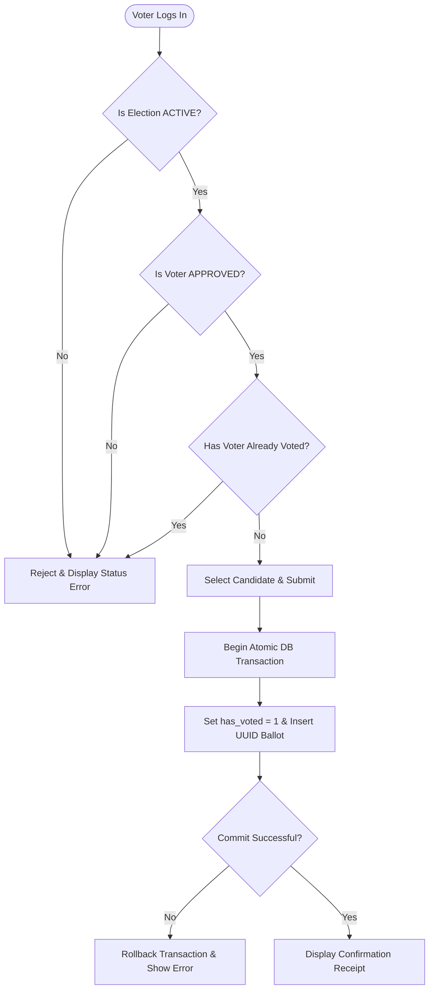

# 🗳️ GP11 Election Management and Voting System (`GP11_EMV_System`)

A secure, privacy-preserving web-based Election Management and Voting System prototype built with Python, Flask, and SQLite. Developed by **Group 11 (GP11)** to demonstrate requirement engineering, role-based access control, atomic ballot processing, and automated validation.

---

## ✨ Key Features & Requirements Coverage

### 1. Functional Capabilities
* **User Registration & Authentication:** Voter self-registration and secure credential validation for both Administrators and Voters.
* **Role-Based Access Control (RBAC):** Strict separation between Administrator management functions and Voter participation interfaces.
* **Election Lifecycle Management:** New elections are private `DRAFT`s. After an administrator confirms a complete roster of at least two candidates, the election follows its configured `UPCOMING`, `ACTIVE`, and `CLOSED` times.
* **Early Election Closure:** Administrators can end an active election early, publish results immediately, and record the action in the audit log.
* **Candidate Management:** Administrators can add, edit, or remove candidates while an election is `DRAFT` or `UPCOMING`. Name and manifesto are required; duplicate names are allowed. Candidate lists lock once voting begins. Changing a confirmed roster returns the election to draft and requires confirmation again.
* **Voter Eligibility Workflow:** Voters can request participation in specific elections (`PENDING`), and Administrators can approve (`APPROVED`) or reject (`REJECTED`) eligibility requests.
* **Electronic Voting & Duplicate Prevention:** Approved voters can cast exactly one ballot during an `ACTIVE` election and receive an immediate confirmation receipt ID.
* **Automated Vote Counting & Publication:** Tallies and percentages remain sealed during active voting and are automatically calculated and published once the election reaches the `CLOSED` state.
* **Administrative Audit Trail:** Records election creation and edits, candidate additions/edits/removals, roster confirmation, voter eligibility decisions, and early closure with timestamps. Changes and their previous/new values are committed together with their audit entry. Unchanged submissions do not add audit records or revoke confirmation.

### Prepare and Confirm an Election

1. Create an election with its title, description, and start/end times. It remains a private **DRAFT**, even when the start time has already arrived.
2. Open the election and add at least **two candidates**. Every candidate must have a non-blank name and manifesto. Adding candidates never starts voting automatically.
3. To edit a candidate, expand **Edit** next to that candidate and use **Save Candidate**. Stale, altered, or deleted-candidate forms are rejected. Candidate IDs are preserved.
4. Review **Election Readiness**, fix any missing information or expired end time, then click **Confirm Election**. Voting starts immediately if the start time has arrived, or automatically at the future scheduled time.

Draft elections are hidden from voters, including direct links and participation/voting endpoints. Existing participation requests remain stored when an election returns to draft. Before voting begins, adding, editing, or removing a confirmed candidate revokes confirmation; confirm the complete roster again afterward. Once voting starts, the roster is locked.

Candidate editing uses administrator-only POST `/admin/election/<election_id>/candidate/<cand_id>/update` with `name`, `manifesto`, and `edit_token`. Confirmation uses POST `/admin/election/<election_id>/confirm` with `confirmation_token`. Signed form snapshots prevent stale candidate edits and confirmation of a changed roster or schedule. Candidate changes, confirmation, and voting recheck current state after obtaining a SQLite write lock.

### Election Editing Rules

Administrators can open an election and use the **Edit Election** panel. The form is prefilled with the current details.

| Current state | Editable fields |
| :--- | :--- |
| `DRAFT` | Title, description, start time, and end time; an expired draft can be rescheduled |
| `UPCOMING` | Title, description, start time, and end time |
| `ACTIVE` | Title, description, and end time; the start time is locked and the end time may only stay the same or be extended |
| `CLOSED` | None; election settings are locked |

The title must contain non-whitespace text; the description may be empty. Both times must be valid dates in `YYYY-MM-DDTHH:MM` format, with the start before the end. When editing a confirmed upcoming election, the start time must remain in the future. A draft remains editable after its original end time, but must have an unexpired end time before confirmation. Closed elections cannot be reopened through editing. The existing **End Election Early** action remains available for active elections.

Edits use the administrator-only POST route `/admin/election/<election_id>/update` with `title`, `description`, `start_time`, and `end_time` fields. The backend acquires a SQLite write lock (`BEGIN IMMEDIATE`) before reloading the election and applying the state rules. A stale form cannot shorten a more recently extended end time or overwrite an election that has already closed. The edit and its audit entry are committed or rolled back together; candidates, participation requests, and accepted ballots are preserved. Submitting unchanged values does not create an audit entry.

### 2. Non-Functional & Privacy Architecture
* **Ballot Secrecy (Privacy by Design):** Voter participation status (`voter_participation` table) and actual candidate choices (`ballots` table) are stored in separate tables. The `ballots` table uses random UUIDs (`UUID v4`) and omits voter foreign keys and timestamps to prevent identity correlation.
* **ACID Data Integrity:** Ballot insertion and the voter's `has_voted` flag update are executed inside a single atomic SQLite transaction (`with db:`). Any unexpected failure triggers a full rollback.
* **Password Security:** All user passwords are salted and hashed using `werkzeug.security`.

---

## 🏗️ System Architecture

The application follows a modular **three-layer architecture**:
1. **Presentation Layer (Frontend):** Responsive Bootstrap 5 interface rendering dashboards, candidate lists, ballot forms, and live audit logs.
2. **Application Layer (Backend):** Python Flask controllers handling authentication, RBAC decorators (`@login_required`, `@admin_required`), eligibility verification, and atomic transaction control.
3. **Data Layer (Database):** Relational SQLite database (`election_system.db`) enforcing foreign key constraints, composite primary keys, and domain checks.



---

## 📂 Repository Structure

```text
GP11_EMV_System/
├── app.py                        # Development entry point
├── election_system/
│   ├── __init__.py               # Application factory and configuration
│   ├── auth.py                   # Authentication, registration and access checks
│   ├── elections.py              # Dashboard and election details
│   ├── voting.py                 # Participation and ballot submission
│   ├── admin.py                  # Election, candidate and eligibility management
│   ├── services.py               # Election status and atomic voting rules
│   ├── db.py                     # SQLite schema, migrations, connections and queries
│   └── templates/                # Shared layout and page templates
├── test_app.py                   # Automated Pytest suite
├── test_candidate_management.py  # Candidate, readiness, migration and race tests
├── project_dependencies.txt      # Python package dependencies
└── README.md                     # Project documentation
```

The database defaults to `election_system.db` in the current working directory. Both `python app.py` and `python app.py --admin` initialize missing tables. A fresh database starts empty. Tests use a separate temporary database and signing key.

Existing databases receive a one-time, transactional `is_confirmed` migration. Closed elections stay closed; unfinished elections with at least two complete candidates retain their schedule; unfinished elections with incomplete rosters and no ballots become drafts. Repeated initialization never reconfirms drafts or resets existing data.

The migration performs its preflight before changing the schema or data. If an unfinished election has accepted ballots but lacks two complete candidates, startup stops and lists its ID. Use the previous application version to end that election, then restart the upgrade. Ballots, participation requests, candidate IDs, and audit history are preserved.

Before upgrading, stop older application processes and make a backup of the SQLite database. Set a new private `SECRET_KEY` when upgrading from the version with a built-in signing key, then sign in again and reload any open forms. The upgrade preserves user IDs, elections, ballots and audit history. The previous demo voter credentials are blocked for voter registration and sign-in. Use `python app.py --admin` to change an existing administrator's username or password.

### Naming and organization conventions

- Use `snake_case` for Python modules, functions, variables and template filenames, `PascalCase` for classes, and `UPPER_SNAKE_CASE` for constants.
- Keep related database operations together in `db.py`; route modules handle HTTP requests and services handle election and voting rules. Data helpers leave commits and rollbacks to their callers.
- Reuse the original section comments and add matching headings for new functional sections.
- Keep public URLs and database identifiers stable unless a change and migration are explicitly planned.

---

## 🚀 Installation & Setup Guide

### Prerequisites
* **Python 3.9+** installed on Windows, macOS, or Linux.

### 1. Clone the repository
```powershell
git clone https://github.com/<your-username>/GP11_EMV_System.git
cd GP11_EMV_System
```

### 2. Create and activate a virtual environment

For WSL, Linux or macOS, use these commands.

```bash
python3 -m venv .venv
source .venv/bin/activate
```

For Windows PowerShell, use these commands.

```powershell
py -m venv .venv
.\.venv\Scripts\Activate.ps1
```
*(If `pip` is missing in your virtual environment, run `python -m ensurepip --upgrade` first).*

### 3. Install dependencies
```powershell
python -m pip install -r project_dependencies.txt
```

### 4. Set the signing key

Set `SECRET_KEY` to a securely generated random value of at least 32 characters. Generate it once and keep the same private value across application processes and restarts. Keep it in your secret store and load it into each shell or service environment that runs the application.

To generate the initial value in WSL, Linux or macOS, run the following in your shell.

```bash
export SECRET_KEY="$(python -c 'import secrets; print(secrets.token_urlsafe(48))')"
```

In Windows PowerShell, run the equivalent command.

```powershell
$env:SECRET_KEY = (python -c "import secrets; print(secrets.token_urlsafe(48))")
```

### 5. Set up the administrator

```bash
python app.py --admin
```

On a fresh database, enter a username of your choice and a password with at least eight characters, including an English letter and a digit. If administrators already exist, the command lists their usernames and offers an optional password reset. During a reset, enter a new username or leave it blank to keep the current one. Password prompts hide input. The command exits after setup.

### 6. Run the application

```bash
python app.py
```

For local use, open `http://127.0.0.1:5000` and sign in with the administrator account you set up. This launcher listens on loopback and runs with debug mode off. For WSGI deployment, serve `app:app` over HTTPS. The WSGI configuration enables the `Secure` flag on session cookies by default.

---

## 🧪 Running Automated Tests

The automated test suite uses temporary SQLite databases to verify authentication, role-based access, election and candidate management, template escaping, result visibility, atomic voting, duplicate prevention, database reinitialization, and early election closure.

Election-edit tests cover state-specific permissions and form controls, date and title validation, administrator-only POST access, stale end times, state changes while waiting for a write lock, audit failure rollback, and preservation of candidates, participation requests, and ballots.

Candidate/readiness tests also cover required names and manifestos, signed stale-form protection, independent edit forms, confirmation revocation, draft privacy, zero/one/two-candidate thresholds, scheduled and immediate activation, expired draft recovery, transaction rollback, actual SQLite lock waits, and legacy migration preflight and rollback.

Run the test suite from your terminal:
```powershell
python -m pytest -v
```

---

## 🔮 Future Evolution Roadmap

This prototype is designed for internal organisational and student society elections. Planned future enhancements include:
* **Multiple Voting Methods:** Ranked-Choice (Instant-Runoff) and Approval voting modules.
* **Cryptographic E2E Verifiability:** Zero-knowledge ballot receipts and public bulletin board verification.
* **Configurable Result Visibility:** Optional live tallying and minimum quorum enforcement.
* **Accessibility & SSO:** WCAG 2.1 AA compliance and university/enterprise OAuth 2.0 integration.
